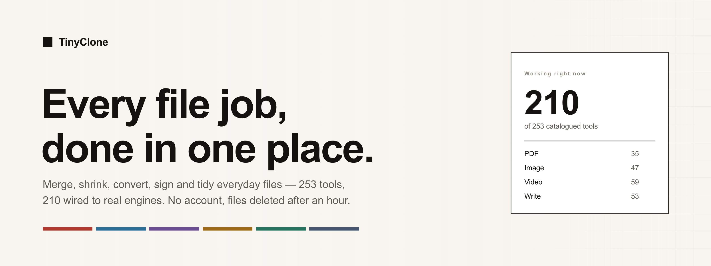
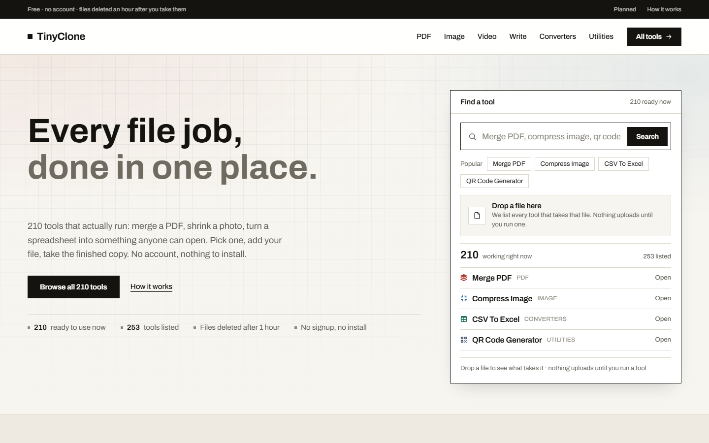
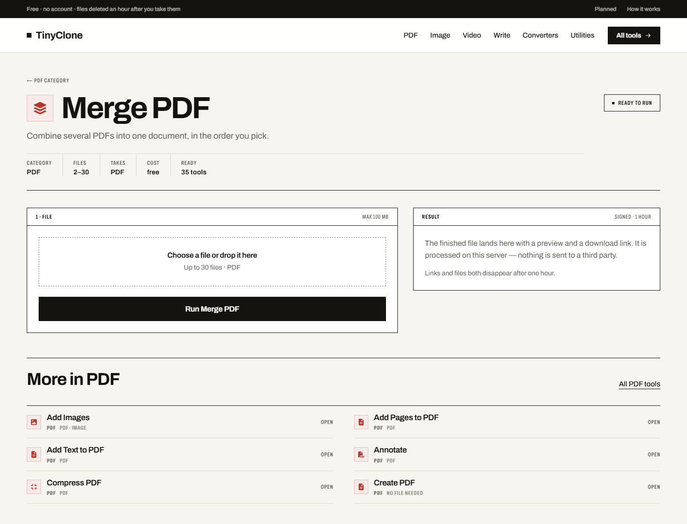
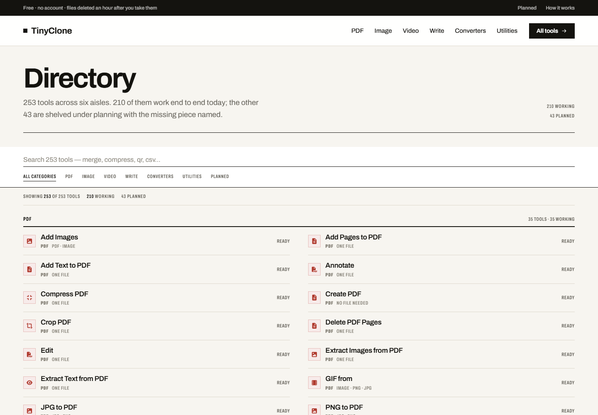

<h1 align="center">TinyClone</h1>

<p align="center">
  <b>Every file job, done in one place.</b><br/>
  253 everyday file tools in the browser — merge, shrink, convert, sign and tidy.
  210 of them are wired to real engines, no account required.
</p>

<p align="center">
  <a href="https://tinyclone-lake.vercel.app"></a>
  <a href="https://github.com/Dev-hari1433/Tinywow/stargazers"></a>
  <a href="https://github.com/Dev-hari1433/Tinywow/network/members"></a>
</p>

<p align="center">
  
  
  
  
  
  
  
</p>

<p align="center">
  <a href="https://tinyclone-lake.vercel.app">Live app</a> ·
  <a href="#features">Features</a> ·
  <a href="#quick-start">Quick start</a> ·
  <a href="#deploy-on-vercel">Deploy</a> ·
  <a href="#api">API</a> ·
  <a href="docs/INSPECTION.md">Inspection notes</a>
</p>

---

## Screenshots

<table>
  <tr>
    <td width="50%"></td>
    <td width="50%"></td>
  </tr>
  <tr>
    <td align="center"><sub><b>Home</b> — search, drop a file, or jump straight into a tool.</sub></td>
    <td align="center"><sub><b>Any tool</b> — upload, pick two options, take the result.</sub></td>
  </tr>
</table>

<p align="center">
  
  <br/>
  <sub><b>Directory</b> — every tool keeps its real name and route, and says whether it runs today.</sub>
</p>

---

## What this is

TinyClone is a full-stack reimplementation of a **tinywow.com**-style file toolbox: a single
catalogue of 253 tools across six categories, a server that processes the files with real
libraries, and a workbench UI that gets out of the way.

The honest part: **210 tools run end to end**, and the remaining **43 are marked Planned** with
the concrete missing dependency named on their page. Nothing silently returns your input file as
a fake result.

```
253 tools · 6 categories · 210 ready · 43 planned · 1-hour retention · no accounts
```

| Category | In catalogue | Working | What lives there |
|---|---:|---:|---|
| 📄 PDF | 47 | 35 | Merge, split, compress, watermark, sign, annotate, extract text/images |
| 🖼️ Image | 76 | 47 | Compress, resize, crop, convert, round corners, make memes, favicons |
| 🎬 Video & audio | 59 | 59 | Trim, convert, mute, extract audio, GIFs, ringtones, format swaps |
| ✍️ Write (AI) | 53 | 53 | Summarise, paraphrase, rewrite, generate copy, translate, transcribe |
| 🔁 Converters | 13 | 11 | CSV ↔ Excel ↔ JSON ↔ XML, PDF ↔ images, documents ↔ text |
| 🧰 Utilities | 5 | 5 | QR codes, Unix timestamps, hashes, lorem ipsum, colour tools |

---

## Features

### The workbench
- **Search-first landing page** — type "merge pdf" or "qr" and get the tool, not a marketing page.
- **Drop-a-file finder** — drop any file and see which tools accept it.
- **One workspace for every tool** — same upload pane, same option form, same result pane.
- **Live job progress** — queued → running → done, with per-engine progress messages.
- **Previews before download** — images, PDFs, audio and video render in the result pane.
- **Signed, expiring links** — HMAC-signed download URLs that die with the file.

### Processing
- **Real engines, not wrappers** — `pdf-lib`, `pdfjs-dist`, `sharp`, `@napi-rs/canvas`,
  `ffmpeg`, `xlsx`, `docx`, `pptxgenjs`, `mammoth`, `ag-psd`, `potrace`, `qrcode`.
- **PDF**: merge, split, rotate, crop, compress, watermark, page numbers, sign, annotate,
  extract text, extract images, PDF → JPG/PNG, JPG/PNG → PDF.
- **Image**: compress, resize, crop, circle crop, convert between PNG/JPG/WebP/AVIF, add
  images, add text, meme generator, favicon set, watermark, filters.
- **Video/audio**: trim, convert containers and codecs, mute, strip audio, extract audio,
  audio format conversion, video → GIF, GIF → video, ringtones.
- **Data**: CSV/Excel/JSON/XML conversions, PDF tables → spreadsheet, document → text.
- **AI writing**: 53 generators and rewriters with a five-provider fallback chain.
- **Speech**: Whisper transcription, subtitle generation, YouTube summarising.

### Platform
- **No account, no cookies, no dashboard.** Open a tool and use it.
- **One-hour retention** — links and files expire together; a sweep removes the bytes.
- **Server-side processing** — files are not shipped to a third party for static tools.
- **Accessible, responsive UI** — keyboard focus states, ARIA labels, mobile layout.
- **Type-safe end to end** — strict TypeScript, no `any` in the catalog surface.

### AI that degrades gracefully
- Providers are tried in preference order, then by measured latency.
- A failing model gets a cooldown (429 → 60 s, 5xx → 2 min, auth/unknown → 1 h) and is skipped.
- When everything is cooling, the whole pool is retried instead of failing outright.
- Health and the discovered free-model list persist between restarts.

---

## How it works

```text
Browser                    Next.js on Vercel                       Storage
───────                    ──────────────────                      ───────
drop file  ──upload──▶     /api/upload      ──bytes──▶             Vercel Blob (private)
                                  │
run tool   ──create──▶     /api/jobs        ──queue──▶ engine ──▶  Blob outputs
                                  │                        │
poll       ──status──▶     /api/jobs/[id]  ◀──progress────┘
                                  │
download   ──signed──▶     /api/download/[jobId]/[outputId] ──▶    streamed back
```

1. **Upload** — files go to private Blob storage (100 MB per file locally, 4.5 MB per request
   on Vercel — see [platform notes](#vercel-platform-notes)).
2. **Create job** — the server validates the tool, its file count and every declared parameter.
   Unknown parameters never reach an engine.
3. **Process** — the engine runs on Fluid Compute; inputs are staged to `/tmp`, outputs are
   written back to Blob, and progress is written to the job record.
4. **Take the copy** — the result pane polls the job, then shows a preview and a signed,
   one-hour download link.

### Storage strategy

| Context | Metadata | Files |
|---|---|---|
| Local development | SQLite via `node:sqlite` in `.data/` | `.data/uploads`, `.data/outputs` |
| Vercel | JSON blobs under `tc/jobs/*`, `tc/files/*` | private Vercel Blob under `tc/uploads/*`, `tc/outputs/*` |

The switch is automatic: if `BLOB_STORE_ID` (or `BLOB_READ_WRITE_TOKEN`) is present, the app
uses Blob, otherwise it uses the local filesystem. No code changes needed between the two.

---

## Quick start

**Requirements:** Node.js **22+** (24 LTS recommended — the app uses `node:sqlite`), npm 10+.

```bash
# 1. clone
git clone https://github.com/Dev-hari1433/Tinywow.git
cd Tinywow

# 2. install (downloads the bundled ffmpeg/ffprobe binaries)
npm install

# 3. configure the optional AI keys
cp .env.example .env.local

# 4. run
npm run dev          # http://localhost:3000
```

Static file tools work with **no keys at all**. AI, OCR, speech and YouTube tools light up when
at least one provider key is present.

### Environment variables

Every provider is optional; the AI router probes them at runtime and uses whatever answers.

| Variable | Required | Purpose |
|---|---|---|
| `GROQ_API_KEY` | optional | Default text model (`qwen/qwen3.8-27b`) and Whisper transcription |
| `GEMINI_API_KEY` | optional | Second text model and vision OCR fallback |
| `MISTRAL_API_KEY` | optional | Third text model, Mistral OCR, Voxtral transcription |
| `OPENROUTER_API_KEY` | optional | Every free model it lists, appended as extra fallbacks |
| `BYTEZ_API_KEY` | optional | Only used when `BYTEZ_MODEL` names a model its catalogue serves |
| `AI_PREFERRED_MODEL` | optional | Pin the first model, e.g. `groq:qwen/qwen3.8-27b` |
| `AI_PROVIDER` | optional | Force one provider: `groq` / `gemini` / `mistral` / `openrouter` / `bytez` |
| `AI_COOLDOWN_SECONDS` | optional | How long a failing model is skipped (default `600`) |
| `AI_TIMEOUT_MS` | optional | Per-request deadline (default `60000`) |
| `AI_DEBUG` | optional | `1` logs every model attempt to stderr |
| `APP_SECRET` | recommended on Vercel | Fixed HMAC key so signed links verify across instances |
| `BLOB_STORE_ID` | set by Vercel | Enables Blob storage instead of the local filesystem |
| `FFMPEG_PATH` / `FFPROBE_PATH` | optional | Override the bundled media binaries |

> **Never commit `.env.local`.** It is already ignored, together with `.env*.local`.

---

## Deploy on Vercel

<p>
  <a href="https://vercel.com/new/clone?repository-url=https://github.com/Dev-hari1433/Tinywow&project-name=tinyclone&repository-name=tinyclone"></a>
</p>

The repository is already connected to Vercel: every push to `main` builds a production
deployment of **[tinyclone-lake.vercel.app](https://tinyclone-lake.vercel.app)**.

### CLI route

```bash
npm i -g vercel@latest
vercel login
vercel link                     # create or link the project
vercel env add APP_SECRET       # paste a random 32+ character string
vercel storage create tinyclone-blob --type blob --access private
vercel storage connect tinyclone-blob
vercel deploy --prod
```

### What to configure in the dashboard

| Setting | Value | Why |
|---|---|---|
| Framework preset | Next.js | Auto-detected |
| Node.js version | 22.x or 24.x | `node:sqlite` built-in |
| Function duration | 300 s (default on Fluid Compute) | Long PDFs and video jobs |
| Blob store | private, connected | Uploads, outputs and job records |
| Env vars | AI keys, `APP_SECRET` | AI tools and cross-instance signed links |

### Vercel platform notes

- **4.5 MB request body limit.** Vercel Functions cap request bodies; local development
  accepts up to 100 MB per file. Large video uploads therefore work locally, but not through the
  hosted demo unless you upload straight to Blob from the browser.
- **Serverless storage.** The app directory is read-only and `/tmp` is per-instance, which is
  why uploads, outputs and job metadata live in Vercel Blob in production.
- **Background work.** The job runs after the response using `waitUntil`, inside the
  function's 300 s budget. Very long media jobs should be moved to a queue or a Daemon.
- **Private Blob.** Outputs are only reachable through the signed download route; nothing is
  publicly listable.

---

## API

| Method | Route | Purpose |
|---|---|---|
| `POST` | `/api/upload` | Multipart upload; returns file IDs and metadata |
| `POST` | `/api/jobs` | Validate a tool + params and enqueue a job; returns `{ jobId }` |
| `GET` | `/api/jobs/[id]` | Job status, progress, message and signed output URLs |
| `GET` | `/api/download/[jobId]/[outputId]` | Stream an output; requires `exp` + `sig` |
| `GET` | `/api/ai/status` | Health of every AI model in the fallback chain |

```bash
# create a job
curl -X POST https://tinyclone-lake.vercel.app/api/jobs \
  -H 'content-type: application/json' \
  -d '{"category":"write","slug":"paraphrasing","fileIds":[],"params":{"text":"Hello world"}}'

# poll it
curl https://tinyclone-lake.vercel.app/api/jobs/<jobId>
```

---

## Tech stack

| Layer | Choice |
|---|---|
| Framework | Next.js 15.5 (App Router), React 19, TypeScript 5.7 |
| Styling | Hand-written CSS with design tokens, self-hosted Archivo |
| Icons | Font Awesome paths inlined through `lib/tool-icon.tsx` |
| PDF | `pdf-lib`, `pdfjs-dist`, `@napi-rs/canvas` |
| Images | `sharp`, canvas, `potrace`, `ag-psd`, `exifr` |
| Media | bundled `ffmpeg-static` 6.1 + `ffprobe-static` |
| Documents | `xlsx`, `docx`, `pptxgenjs`, `mammoth`, `jszip`, `marked` |
| Utilities | `qrcode`, `jszip` |
| Storage | `node:sqlite` + filesystem locally, Vercel Blob in production |
| AI | five-provider router with health tracking and cooldowns |
| Hosting | Vercel, Fluid Compute, private Blob, GitHub auto-deploy |

---

## Project structure

```text
app/
  page.tsx                  landing page: finder, categories, featured tools
  tools/page.tsx            the 253-tool directory
  [category]/[tool]/        one page per tool, from the catalogue
  components/               Finder, CatalogBrowser, ToolWorkspace
  api/
    upload/                 multipart upload → Blob or disk
    jobs/                   create job + poll status
    download/               signed, expiring output stream
    ai/status/              live model health
lib/
  catalog.ts                the whole 253-tool catalogue and its params
  engines/                  pdf, image, media, data, speech, ai, other
  ai/router.ts              provider discovery, ranking, fallbacks
  db.ts                     SQLite or Blob-backed job store
  store.ts                  Vercel Blob helpers (private reads/writes)
  queue.ts                  in-process job runner with waitUntil
  signed.ts                 HMAC download links
public/fonts/               self-hosted Archivo subsets
docs/
  INSPECTION.md             source-site inspection evidence
  assets/                   banner, logo, screenshots
```

---

## Quality checks

```bash
npm run typecheck      # strict TypeScript, no emit
npm run build          # production build
npm run test:tools     # every wired engine against real fixtures
npm run test:routes    # route + API contract checks
npm run test:ui        # end-to-end workspace behaviour
npm run test:semantics # catalogue honesty: ready vs planned
npm run test:ai        # AI router fallback behaviour
```

---

## Roadmap

The 43 planned tools keep their real names, routes and categories; each page names what is
missing. Highlights still on the shelf:

- EPUB → MOBI / AZW3
- HEIC → JPG / PNG / AVIF
- PSD → AI / SVG, EPS → JPG / PNG / SVG
- AI image generator, background blur and photo colourisation

---

## Disclaimer

An independent reimplementation, rebuilt for study and demonstration. Not affiliated with,
endorsed by, or connected to tinywow.com or its owners. Product names and tool labels are used
descriptively; all processing runs on this project's own code and libraries.

<p align="center"><sub>Built with Next.js · Deployed on Vercel · Files deleted after one hour</sub></p>
